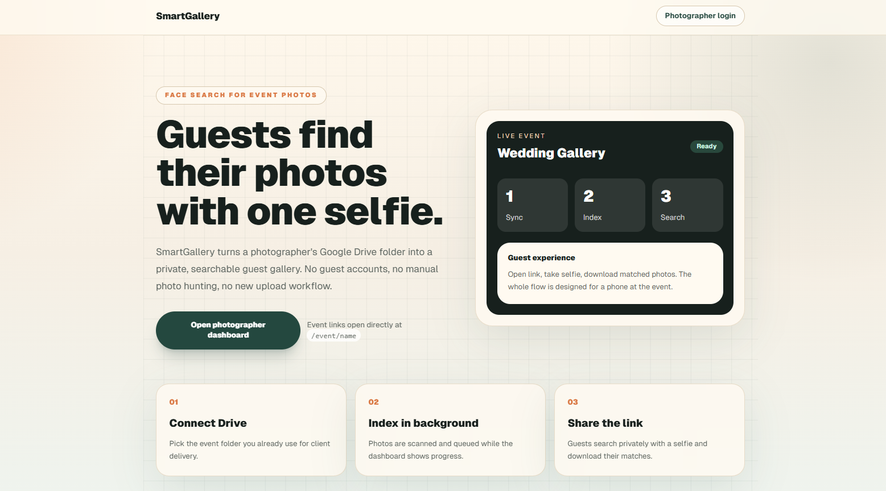
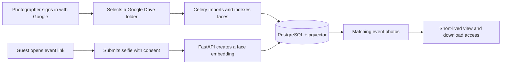

# SmartGallery

[](https://github.com/sayan365/smartgallery/actions/workflows/ci.yml)
[](./LICENSE)
[](https://www.python.org/)
[](https://nextjs.org/)

**Open-source, AI-powered event photo discovery using face recognition and Google Drive.**

SmartGallery helps photographers turn an event folder into a searchable photo gallery.
Photographers connect a Google Drive folder, SmartGallery indexes the faces in its images,
and guests submit a selfie to find the event photos in which they appear.

[](./docs/assets/smartgallery-homepage.png)

<p align="center"><em>Connect a Drive folder, index event photos in the background, and share a private selfie-search link with guests.</em></p>

> [!IMPORTANT]
> The complete photographer workflow requires **Supabase Auth with Google sign-in**, a
> Google Cloud OAuth application with the **Google Drive read-only scope**, PostgreSQL with
> pgvector, and Redis. Local development mode can exercise the dashboard and database without
> Supabase, but it cannot browse or synchronize Google Drive without real Google OAuth access.

## Why SmartGallery?

- **Selfie-based photo search:** guests find relevant event photos without browsing thousands
  of images.
- **Google Drive workflow:** photographers continue organizing and owning their original files
  in Drive.
- **Automatic face indexing:** Celery workers detect faces and store searchable embeddings in
  PostgreSQL with pgvector.
- **Multi-event dashboard:** create, synchronize, archive, restore, and share event galleries.
- **Privacy controls:** explicit search consent, in-memory selfie processing, configurable
  retention, rate limiting, and short-lived photo access tokens.
- **Self-hostable stack:** Next.js, FastAPI, InsightFace, PostgreSQL, pgvector, Redis, and
  Celery.

## How it works



Original photos stay in the photographer's Google Drive. SmartGallery stores file metadata
and face embeddings, processes guest selfies in memory, and proxies authorized photo results
through expiring, event-bound access tokens.

## Core features

| Area | Capabilities |
| --- | --- |
| Photographer | Google sign-in, Drive folder picker, event management, sync and reindex controls |
| Guest | Public event link, camera or file selfie, consent flow, matched gallery and downloads |
| Face search | InsightFace detection and embeddings, pgvector similarity search, configurable threshold |
| Background jobs | Drive polling, batch indexing, retry handling, and retention cleanup with Celery |
| Security | Supabase JWT validation, encrypted OAuth tokens, upload validation, rate limiting, signed photo access |
| Privacy | No stored selfies, configurable search-record retention, deletion controls, privacy notice |

## Technology stack

| Layer | Technology |
| --- | --- |
| Web application | Next.js 14, React 18, TypeScript, Tailwind CSS |
| API | Python 3.11+, FastAPI, SQLAlchemy, Alembic |
| Face recognition | InsightFace, ONNX Runtime, OpenCV |
| Database | PostgreSQL with pgvector; Supabase recommended for hosted deployments |
| Authentication | Supabase Auth with Google OAuth |
| Photo source | Google Drive API v3 |
| Jobs and cache | Celery and Redis |

## Requirements for full functionality

SmartGallery's production workflow depends on the following services:

1. **Supabase**
   - PostgreSQL database with the pgvector extension.
   - Supabase Auth with the Google provider enabled.
   - Project URL, public anonymous key, service-role key, and JWT configuration.
2. **Google Cloud**
   - Google Drive API enabled.
   - OAuth 2.0 web client connected to the Supabase callback URL.
   - `openid`, `email`, `profile`, and
     `https://www.googleapis.com/auth/drive.readonly` scopes.
   - Offline access and consent so Drive refresh tokens are available.
3. **Redis**
   - Celery broker and result backend for synchronization and face-indexing jobs.

Follow the [cloud setup guide](./docs/12-cloud-setup-plan.md) for the complete configuration,
redirect URLs, environment variables, migrations, and verification checklist.

## Quick start

### 1. Clone and install the backend

```bash
git clone https://github.com/sayan365/smartgallery.git
cd smartgallery/backend
python -m venv .venv
```

Activate the virtual environment:

```powershell
# Windows PowerShell
.\.venv\Scripts\Activate.ps1
```

```bash
# macOS or Linux
source .venv/bin/activate
```

Install the application and development dependencies:

```bash
python -m pip install -r requirements-dev.txt
```

### 2. Choose an infrastructure setup

For the complete application, copy `backend/.env.example` to `backend/.env`, configure
Supabase, Google OAuth, and Redis, then apply the migrations:

```bash
cd backend
alembic upgrade head
```

For an isolated Windows development database without Supabase, start Docker Desktop and run
this command from the repository root:

```powershell
.\scripts\setup-local.ps1
```

The script starts loopback-only PostgreSQL/pgvector and Redis containers, applies all
migrations, and generates ignored local development credentials. This mode supports local
dashboard and database testing but not Google Drive operations.

### 3. Start the API and workers

Run each command in a separate terminal from `backend/`:

```bash
python -m uvicorn app.main:app --reload --port 8000
celery -A app.worker.celery_app worker --loglevel=info
celery -A app.worker.celery_app beat --loglevel=info
```

### 4. Start the frontend

```bash
cd frontend
npm ci
```

For a full Supabase deployment, copy `frontend/.env.example` to `frontend/.env.local` and
enter the project URL and anonymous key. The local setup script creates a development-only
configuration automatically.

```bash
npm run dev
```

Open:

- Web application: <http://localhost:3000>
- Photographer dashboard: <http://localhost:3000/admin>
- API health check: <http://localhost:8000/api/health>
- API documentation in development: <http://localhost:8000/docs>

## Project structure

```text
smartgallery/
|-- backend/              FastAPI API, Celery jobs, migrations, and tests
|-- frontend/             Next.js public gallery and photographer dashboard
|-- docs/                 Architecture, requirements, API, and deployment guides
|-- scripts/              Local development automation
|-- compose.yaml          Local PostgreSQL/pgvector and Redis services
`-- README.md
```

## Testing

```bash
cd backend
pytest tests -q -p no:cacheprovider

cd ../frontend
npm run lint
npm run typecheck
npm run build
```

CI runs the backend security tests, frontend linting, TypeScript checks, production build,
and dependency audits for every pull request and push to `main`.

## Security and privacy

Face recognition and contact-data collection may be regulated in your jurisdiction. Before
allowing real users, deployers must establish an appropriate legal basis, obtain required
consent, publish an operator-specific privacy notice, and configure a suitable retention
period.

SmartGallery includes secure defaults, but no default configuration makes a deployment
automatically compliant. Read:

- [Security policy and vulnerability reporting](./SECURITY.md)
- [Privacy and biometric-data considerations](./PRIVACY.md)
- [Deployment configuration guide](./docs/12-cloud-setup-plan.md)

Never commit environment files, Supabase service-role keys, Google OAuth secrets, real event
photos, selfies, face embeddings, or guest contact information.

## Documentation

| Guide | Description |
| --- | --- |
| [Documentation index](./docs/README.md) | All architecture, product, and technical documents |
| [Cloud setup](./docs/12-cloud-setup-plan.md) | Supabase, Google OAuth, Redis, and deployment configuration |
| [Architecture](./docs/02-architecture.md) | Components, data flow, and design decisions |
| [Google Drive integration](./docs/05-google-drive.md) | OAuth scopes and Drive synchronization |
| [Database schema](./docs/09-database-schema.md) | PostgreSQL tables, indexes, and pgvector fields |
| [API reference](./docs/10-api-spec.md) | Authentication, events, search, and photo endpoints |

## Frequently asked questions

### Is Supabase required?

The current production authentication implementation uses Supabase Auth. The application
also requires PostgreSQL with pgvector; that database may be hosted by Supabase or another
compatible provider. A guarded local-development login is available only through the local
setup script.

### Is Google OAuth required?

Yes, for the complete photographer workflow. Google sign-in establishes the photographer's
identity, and the Drive read-only scope allows SmartGallery to browse and synchronize event
photos. Without Google Drive permission, local dashboard and database testing still work,
but photo import and indexing do not.

### Do event guests need accounts?

No. Guests open a public event URL, provide the required consent and a selfie, and receive
matching results. Photographer administration remains authenticated.

### Are selfies or original photos stored by SmartGallery?

Guest selfies are processed in memory and are not persisted. Original photos remain in
Google Drive; the application stores Drive metadata and face embeddings needed for search.

## Contributing

Contributions are welcome. Read [CONTRIBUTING.md](./CONTRIBUTING.md) before opening an issue
or pull request, and follow the [Code of Conduct](./CODE_OF_CONDUCT.md).

For security vulnerabilities, use the private reporting process in [SECURITY.md](./SECURITY.md)
instead of opening a public issue.

## License

SmartGallery is released under the [MIT License](./LICENSE).
