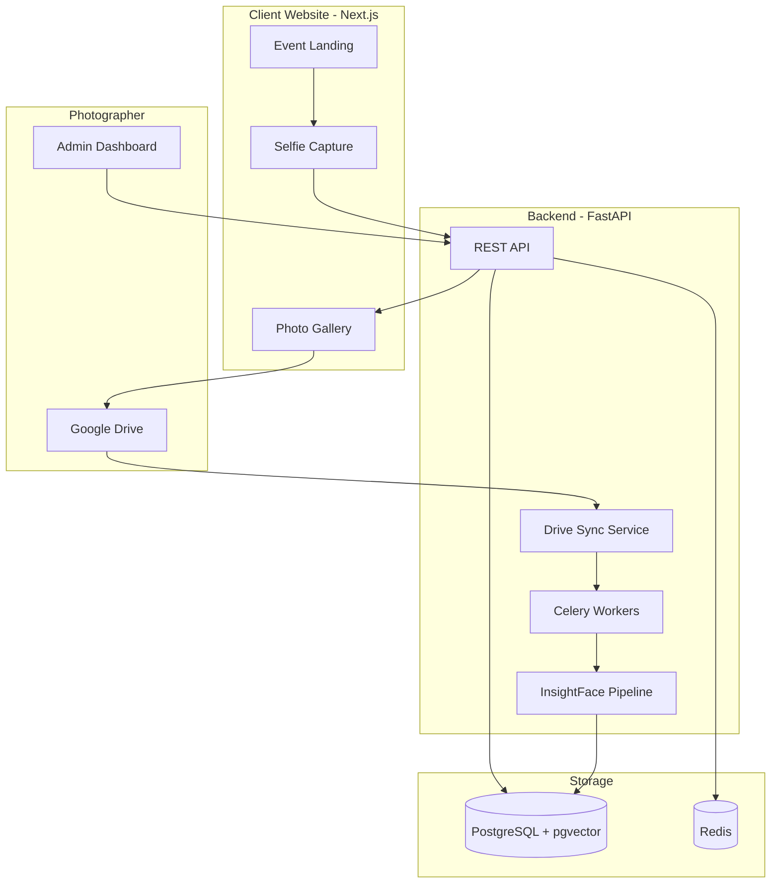

# System Architecture

Three distinct layers: photographer admin, AI processing pipeline, and client-facing website.

## Layer 1 — Photographer & storage

```
Google Drive (photos live here)
    → Drive API sync (watches folder changes)
    → Backend server (triggers processing)
```

## Layer 2 — AI processing pipeline

```
Photo download (temp from Drive)
    → Face detection (InsightFace / RetinaFace)
    → Embedding extract (512-dim face vector)
    → Vector DB store (linked to photo ID)
```

## Layer 3 — Client website

```
Client selfie (webcam / upload)
    → Extract embedding (same AI model)
    → Vector search (find nearest faces)
    → Gallery page (view & download)
```

## Key design decisions

1. **Photos stay on Google Drive** — Platform stores Drive file IDs and face embedding vectors only. Zero photo storage cost; photographers keep full control.
2. **Selfies are never persisted** — Only the 512-dim embedding is used transiently for search; then discarded.
3. **Event-scoped search** — Vector search is filtered by `event_id` so clients only see photos from that event.
4. **Async processing** — Face indexing runs in a background queue (Celery + Redis) so uploads don't block the API.

## Component diagram



## Deployment topology (free tier)

| Component | Host |
|-----------|------|
| Frontend | Vercel |
| API + Workers | Railway or Render |
| PostgreSQL | Supabase |
| Redis | Upstash |
| Photos | Google Drive (photographer's account) |
